<div align="center">

<picture>
  <source media="(max-width: 600px) and (prefers-color-scheme: dark)" srcset="docs/brand/readme-banner-dark-mobile.svg">
  <source media="(max-width: 600px)" srcset="docs/brand/readme-banner-light-mobile.svg">
  <source media="(prefers-color-scheme: dark)" srcset="docs/brand/readme-banner-dark.svg">
  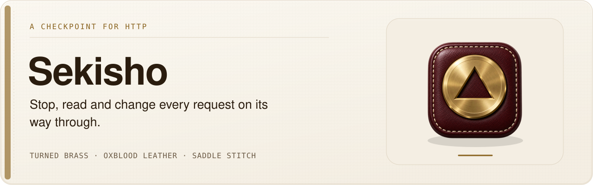
</picture>

<picture>
  <source media="(max-width: 600px) and (prefers-color-scheme: dark)" srcset="docs/brand/readme-showcase-dark-mobile.svg">
  <source media="(max-width: 600px)" srcset="docs/brand/readme-showcase-light-mobile.svg">
  <source media="(prefers-color-scheme: dark)" srcset="docs/brand/readme-showcase-dark.svg">
  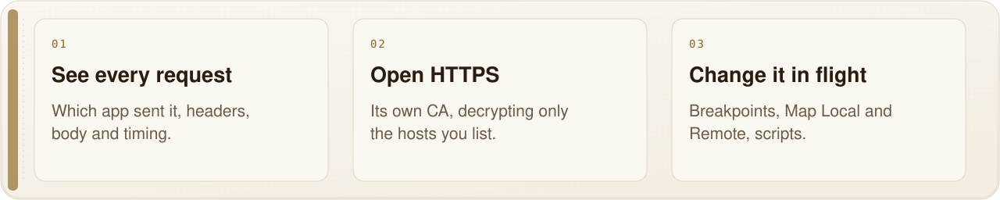
</picture>

<br><br>


# Sekisho · 関所

**A checkpoint for HTTP.**

On the Edo-era roads every traveller stopped at the sekisho, the checkpoint, and showed what
they carried. Sekisho does that for your Mac's traffic. Point an app at it and every request
shows up: which app sent it, the request and the response, headers, body, timing. HTTPS opens
only for the hosts you choose, with a certificate authority that lives on this Mac. Then stop a
request before it leaves, answer it yourself, send it somewhere else, script it or replay it.
A native Mac app on SwiftNIO, in the spirit of Proxyman.


<table>
<tr>
<td align="center"><b>11</b><br><sub>tools, from SSL Proxying to Reverse Proxy</sub></td>
<td align="center"><b>7</b><br><sub>languages for Copy as code</sub></td>
<td align="center"><b>1</b><br><sub>CA, made on this Mac, key 0600</sub></td>
<td align="center"><b>30</b><br><sub>tests, curl through a live proxy</sub></td>
<td align="center"><b>0</b><br><sub>hosts decrypted until you say so</sub></td>
</tr>
</table>

</div>

<br>

<picture>
  <source media="(prefers-color-scheme: dark)" srcset="docs/screenshots/main-dark.webp">
  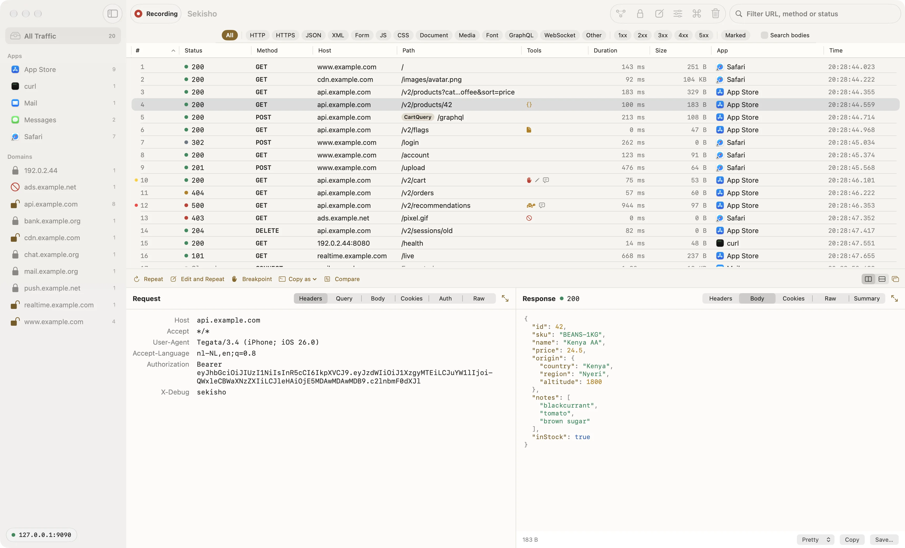
</picture>

<p align="center"><sub>A decrypted JSON response, with the app that asked for it. All screenshots use Sekisho's built-in demo: <code>example.com</code> and <code>192.0.2.44</code> only.</sub></p>

---

## What it does

**Record, and know who sent it.** HTTP and HTTPS, CONNECT tunnels and WebSocket upgrades, each
row with the app that opened the connection. The sidebar groups traffic by app and by domain,
with pins for the ones you watch. Filter chips for the kind of content (JSON, XML, form, JS,
CSS, documents, media, fonts, WebSocket) and for 2xx to 5xx, sortable columns, a search through
bodies, and highlights, strike-through and comments on any row.

**HTTPS, on your terms.** Sekisho makes its own root certificate on first launch. Its private
key stays in `~/Library/Application Support/Sekisho` with mode 0600 and never leaves the Mac,
and trust is limited to TLS server authentication. Nothing is decrypted until a host is on the
SSL Proxying list. An encrypted row says so and offers to decrypt that host, `*.domain` or all
HTTPS, and it takes effect at once: open tunnels to that host close, so the next request
arrives readable without a reload. Upstream certificates are checked against this Mac's trust
store, so a broken or hostile server is reported instead of hidden behind Sekisho's own
certificate. Apps that pin their certificates refuse Sekisho's; those rows show the reason.

**Read it properly.** Headers, query, cookies and raw. Bodies as a JSON tree, text, hex, an
image, or an HTML preview with no JavaScript and no loads, with gzip, deflate and Brotli undone.
Form and multipart tabs, an Auth tab that takes Basic and JWT apart, GraphQL operation names,
WebSocket messages in both directions from RFC 6455 frames, and a Summary with the engine's own
timings: connect, TLS, send, wait, receive. JSON keeps its own key order and number spelling,
with syntax colours, and Format JSON tidies a body in Compose or at a breakpoint. Double-click a row to open it in its own window,
side by side or stacked, and maximise the request or the response.

**Change it in flight.**
- **Breakpoints** stop a request before it leaves, or a response before the app gets it; edit
  it or abort it.
- **Map Local** answers with your own status and body, a file or a folder. **Map Remote** sends
  matching requests to another server, such as staging or localhost.
- **Scripting** in JavaScript, in Proxyman's `onRequest` and `onResponse` shape, with a log.
- **Block List** and **Allow List**, **SSL Exclude**, **DNS Spoofing**, **No Caching**,
  **Network Conditions** with latency and bandwidth presets, and **Reverse Proxy** listeners.

**Replay and share.** Repeat, Edit and Repeat, and Compose, which takes a pasted curl command
and keeps a history without passwords or cookies. Compare two requests side by side or unified.
Copy as cURL, HTTPie, Python, fetch, axios, Swift `URLSession` or Go. Save and open sessions
(`.sekisho`, also from Finder), import and export HAR.

**Reach further, when you choose.** Let phones and other devices on your network join (off by
default, private addresses only, and they cannot reach services on the Mac itself), install the
certificate in iOS Simulators in one click, or send traffic on through another proxy, with its
password in the Keychain.

<table>
<tr>
<td width="50%">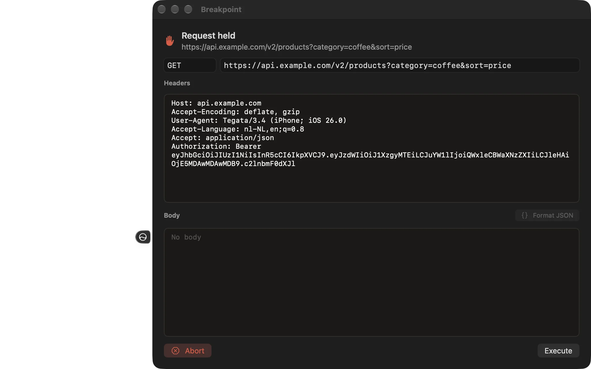<br><sub>Breakpoints: stop a request, change it, let it go.</sub></td>
<td width="50%">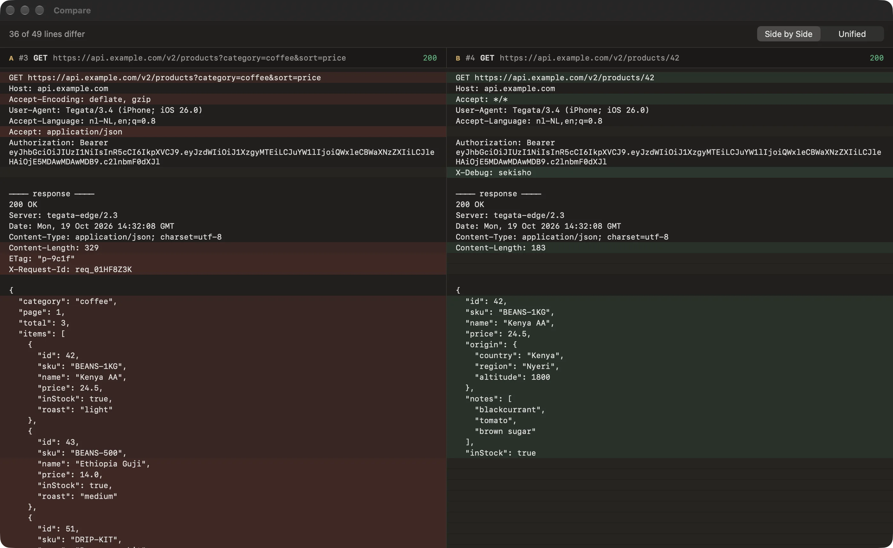<br><sub>Compare two requests, side by side or unified.</sub></td>
</tr>
<tr>
<td width="50%">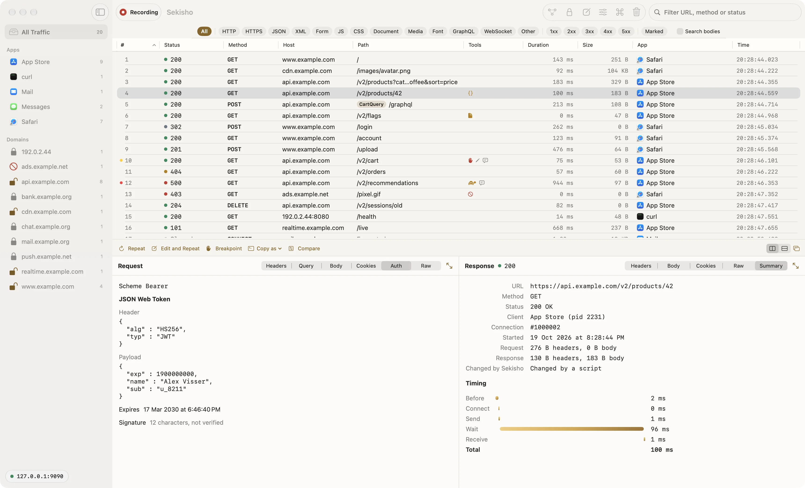<br><sub>JWTs taken apart; timings from the engine itself.</sub></td>
<td width="50%">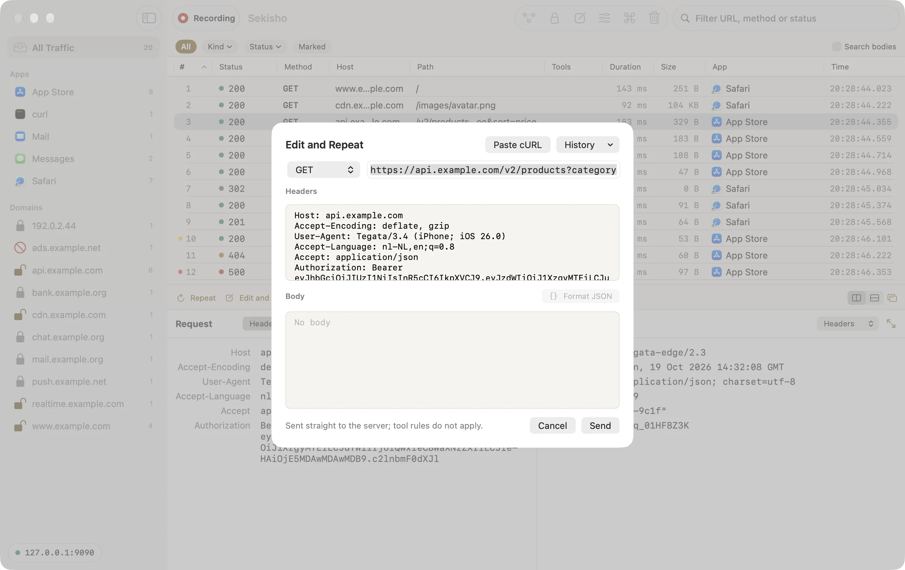<br><sub>Edit and Repeat, or Compose from a pasted curl.</sub></td>
</tr>
<tr>
<td width="50%">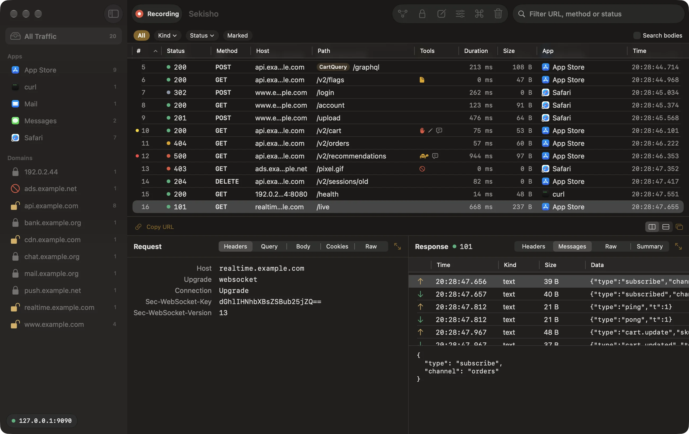<br><sub>WebSocket messages, read from the frames.</sub></td>
<td width="50%">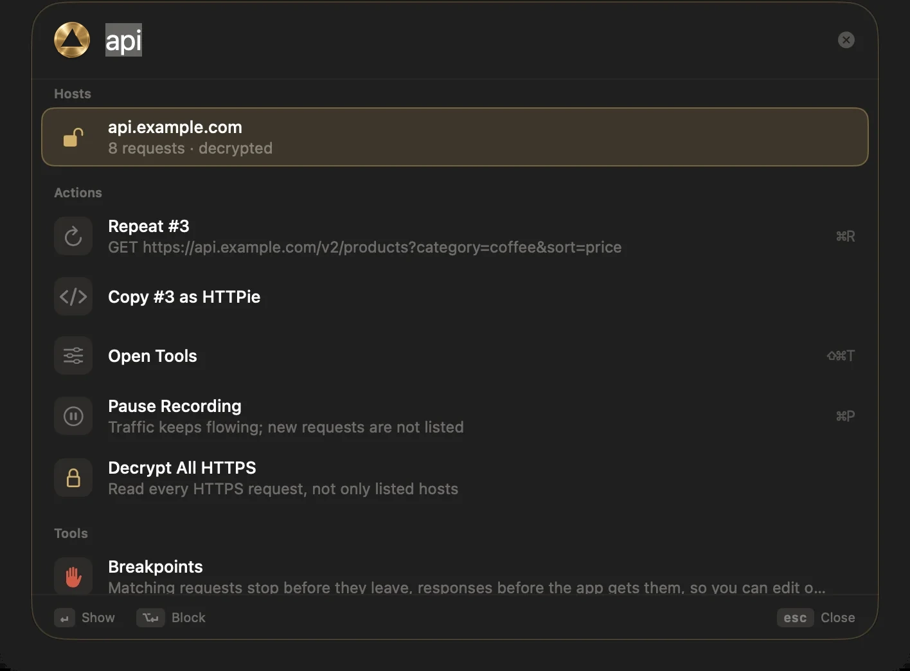<br><sub>⌘K: hosts, requests, actions and tools in one place.</sub></td>
</tr>
</table>

**A first walk down the line.** First launch opens a short welcome: five
stations on a single-track line (Welcome, Certificate, Traffic, Decrypt, Line clear), with the
tablet riding to the one you're at. Each station does the real thing and checks it live, and the
walk ends on your first decrypted request. Skip it any time; Help > Welcome to Sekisho brings it
back.

<p align="center">
<picture>
  <source media="(prefers-color-scheme: dark)" srcset="docs/screenshots/welcome-dark.webp">
  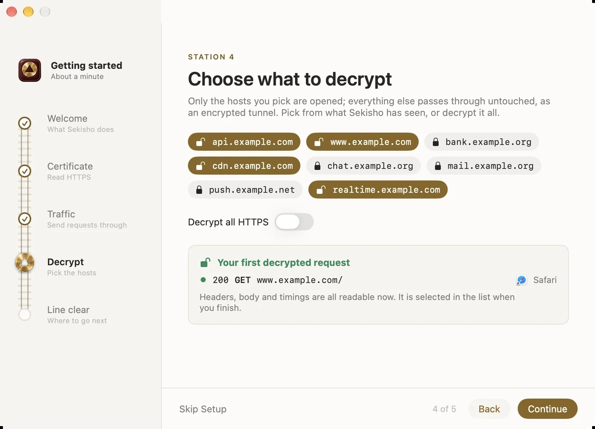
</picture>
</p>

**And a proper Mac app.** ⌘K opens a command palette for actions, tools, filters, hosts, apps
and requests (by URL or `#12`); paste a URL, a curl command or a host name and it offers what
fits. The macOS Proxy switch puts your previous setting back when you turn it off, quit, or
after a crash. Settings come in tabs (General, Upstream, Certificate), and removing trust asks
first. Windows stay usable down to 620 points wide, for tiling window managers. The About window
is an okuzuke colophon with the build, its commit and the mostlygino seal.

## Shortcuts

| Keys | Does |
|---|---|
| ⌘K | Command palette |
| ⌘N | Compose a request |
| ⌘R · ⌥⌘R | Repeat · Edit and Repeat |
| ⌘Y | Compare the two selected requests |
| ⌘P | Pause or resume recording |
| ⇧⌘P | Turn the macOS Proxy on or off |
| ⇧⌘T | Tools |
| ⌥⌘C · ⇧⌘C | Copy as cURL · Copy URL |
| ⌘O · ⌘S | Open a session or HAR · Save a session |
| ⇧⌘E | Export the selection as HAR |
| ⇧⌘K | Clear |

## How it works

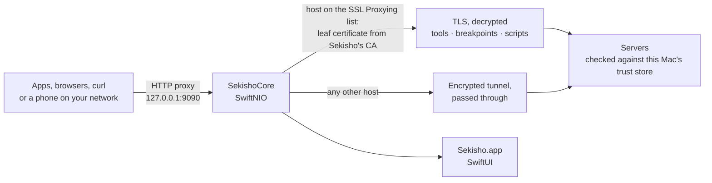

| Path | What |
|---|---|
| `Sources/SekishoCore/` | The engine: proxy and MITM on SwiftNIO, the certificate authority, flows, body decoding, tools, scripting on JavaScriptCore, upstream proxy, sessions, HAR and cURL, code generators |
| `Sources/SekishoApp/` | The Mac app: main window, inspector, Tools, Compose and breakpoint sheets, Compare, the ⌘K palette, About, macOS Proxy and certificate setup |
| `Tests/SekishoTests/` | 30 tests, most with curl through a live proxy: MITM, tools, scripts, throttling, reverse and upstream proxies, WebSocket frames |
| `scripts/` | `check.sh` (tests, then a release build), `install.sh`, `release.sh`, `make-installers.sh` and `make-installer-art.swift` (the DMG and the installer), `sign-release.sh`, `make-icon.swift` |

Why SwiftNIO and not Network.framework: an intercepting proxy has to start serving TLS on a
socket after `CONNECT`, and Network.framework can't. The engine uses SwiftNIO, swift-nio-ssl and
swift-certificates.

## Install

Download [the 0.1.0 beta](https://github.com/mostlygino/Sekisho/releases/tag/v0.1.0). It needs
macOS 26 on Apple silicon.

- **`Sekisho-0.1.0.dmg`**: drag Sekisho to Applications, on a turned-brass background.
- **`Sekisho-0.1.0.pkg`**: the Installer, with a welcome page, the licence and first steps.

`SHA256SUMS` lists the files; GPG signatures from the release key follow. Sekisho is not
notarised, so macOS blocks the first open: choose System Settings > Privacy & Security >
Open Anyway, once. There is no updater yet: install a newer version over the old one.

See it with demo traffic, without touching your proxy, certificates or settings:

```sh
open -n /Applications/Sekisho.app --args -demo YES
# -demoAppearance light|dark   -demoWindow tools[:<tool>]|compose|compare|breakpoint|settings|about|welcome
```

## Build from source

**Needs:** macOS 26 and Xcode.

```sh
./scripts/check.sh      # tests (curl through a live proxy), then a release build
./scripts/install.sh    # build and install into /Applications
```

1. Open Sekisho. It listens on `127.0.0.1:9090`, loopback only; change the port in Settings.
2. Turn on **macOS Proxy** in the toolbar (⇧⌘P), or point one tool at it:
   `curl -x http://127.0.0.1:9090 http://example.com`.
3. To read HTTPS, click **Trust Certificate…** (macOS asks for your password), then decrypt a
   host from its row, from **Tools → SSL Proxying**, or with **Decrypt All HTTPS**.

**Settings → Remove Trust and Delete Key…** removes both; a new root is made at the next launch.

## Privacy

Sekisho runs on this Mac and sends nothing anywhere. It listens on loopback unless you allow
devices on your network. It never changes the system proxy or certificate trust without a
click, and it puts the previous proxy setting back when it's done.

## Status and known limits

Sekisho is a 0.1 beta. The engine and the app are checked by 30 tests and live runs with
headless Chromium; it has not yet had a long run on everyday browser traffic. There is a 0.1.0
beta release, and no updater yet.

- A script that never ends blocks every script until Sekisho restarts.
- Held responses are not slowed down by Network Conditions.
- There is no per-device connection limit in network mode.
- Out on purpose for now: HTTP/2 to the client, SOCKS, a Network Extension, Protobuf and
  MessagePack, per-app SSL rules, tabs, and a CLI or MCP server.

## Contributing

Bug reports, ideas and pull requests are welcome. [CONTRIBUTING](CONTRIBUTING.md) covers the
build, the tests and how the code is laid out; the [code of conduct](CODE_OF_CONDUCT.md)
applies everywhere. Found a security problem? Please report it privately, as
[SECURITY](SECURITY.md) describes, not in an issue. Every release is in the
[changelog](CHANGELOG.md).

## Licence

Code: AGPL-3.0-or-later ([LICENSE](LICENSE)). Name, icon and artwork: all rights reserved, see [BRAND.md](BRAND.md).

## Read more

- [Design](DESIGN.md): the single-line tablet, quiet edition: brass for what you can act on,
  macOS for the rest
- [Product](PRODUCT.md): who Sekisho is for and the promises it keeps
- [Brand](docs/brand/README.md): the five icon options, rendered rather than drawn

<p align="center"><b>If Sekisho helps you, a ⭐ helps others find it.</b></p>

---

<div align="center">


<sub>Built on <a href="https://github.com/apple/swift-nio">SwiftNIO</a>, <a href="https://github.com/apple/swift-nio-ssl">swift-nio-ssl</a>, <a href="https://github.com/apple/swift-certificates">swift-certificates</a> and <a href="https://github.com/apple/swift-crypto">swift-crypto</a>.<br>
Inspired by the category (Proxyman, Charles); the name, code, copy and artwork are its own.<br>
Code under AGPL-3.0-or-later; name, icon and artwork reserved. See <a href="#licence">Licence</a>.</sub>

</div>

<br>

<a href="https://mostlygino.com">
  <picture>
    <source media="(max-width: 600px) and (prefers-color-scheme: dark)" srcset="https://raw.githubusercontent.com/mostlygino/mostlygino/main/assets/signoff/built-with-love-dark-mobile.svg">
    <source media="(max-width: 600px)" srcset="https://raw.githubusercontent.com/mostlygino/mostlygino/main/assets/signoff/built-with-love-light-mobile.svg">
    <source media="(prefers-color-scheme: dark)" srcset="https://raw.githubusercontent.com/mostlygino/mostlygino/main/assets/signoff/built-with-love-dark.svg">
    
  </picture>
</a>
